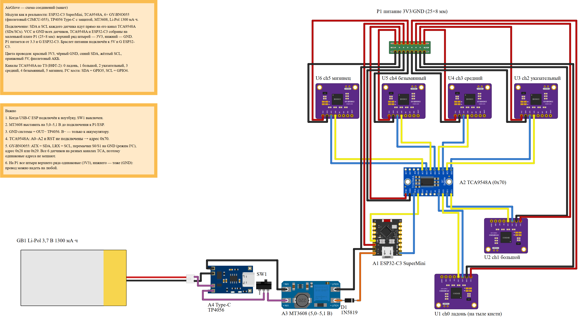

# AirGlove

### Учебный проект по дисциплине «Встроенные системы»

AirGlove - беспроводная перчатка для управления компьютером при помощи движений кисти и пальцев.

## Авторы

- Целиков Даниил Александрович
- Тарасов Владислав Павлович

Группа: **P3319**

## Компоненты

- ESP32-C3 - микроконтроллер.
- 6 × GY-BNO055 (фиолетовые китайские CJMCU-055) - датчики движения.
- TCA9548A - мультиплексор I²C.
- Li-Po аккумулятор, TP4056 и MT3608 - питание и зарядка.

## Схема подключения



Схема сделана в Fritzing на готовых деталях сообщества под наши платы: ESP32-C3 SuperMini,
TCA9548A, TP4056 Type-C с защитой, MT3608, Li-Pol 1300 мА·ч (авторы — в
[tools/fritzing/parts/CREDITS.md](tools/fritzing/parts/CREDITS.md)). Своими деталями нарисованы только
фиолетовый GY-BNO055 (готовой детали для этого клона нет) и наша плата распределения P1.
Проект: [docs/fritzing/AirGlove.fzz](docs/fritzing/AirGlove.fzz), открывается в Fritzing через File → Open.
Все детали встроены в файл, отдельно ставить их не нужно.
Таблица контактов: [docs/connections.md](docs/connections.md).

Как пересобрать (если править не мышкой, а в скрипте):

```bash
python tools/fritzing/build_fzz.py
python tools/fritzing/export_images.py "C:/путь/к/Fritzing.exe"
```

Старые варианты для истории: логическая схема [docs/schema.png](docs/schema.png) (нарисована до переделки P1)
и первая версия из Fritzing [docs/schema_v1_fritzing.png](docs/schema_v1_fritzing.png).

## Материалы

- [Техническое задание проекта](docs/AirGlove_TZ.docx)
- [Схема в Fritzing](docs/fritzing/AirGlove.fzz) ([PNG](docs/fritzing/AirGlove_breadboard.png)) и [таблица контактов](docs/connections.md)
- [Старая логическая схема](docs/schema.png) — нарисована до переделки P1, актуальна схема Fritzing
- [Разводка питания и земли: варианты (своя плата, готовые хабы)](docs/power_distribution_options.md)
- [P1 — маленькая плата питания 3V3/GND: как собрать](docs/p1_board_guide.md)
- [Подключение GY-BNO055 вместо Adafruit BNO055](docs/bno055_module.md)
- [Заметки по сборке: тест на столе, земля, пластина, крепление к перчатке](docs/assembly_notes.md)
- [3D-модель перчатки: какую перчатку купить, что печатать, как крепить](docs/glove_model.md)
  (три способа подключения — [сравнение](docs/model/variants_comparison.png), STL в `docs/model/<режим>/stl`,
  исходники OpenSCAD в `tools/model/`)
