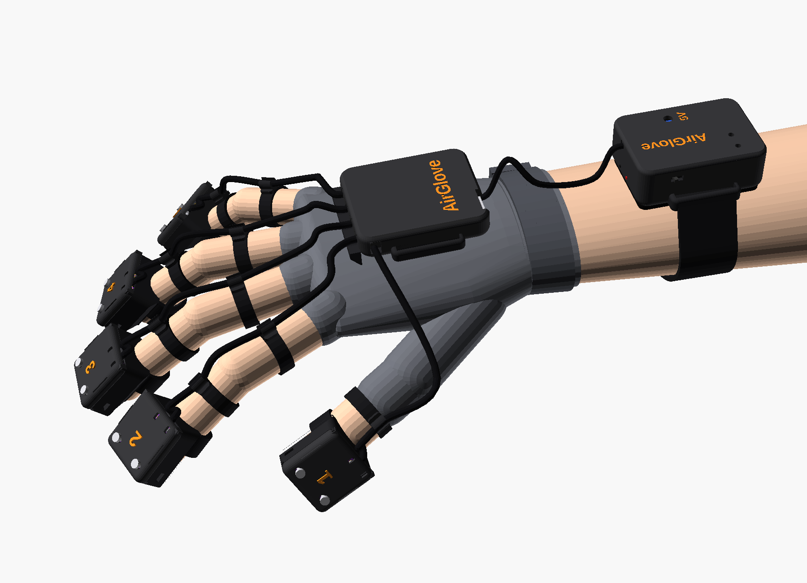

# AirGlove

**AirGlove — беспроводная перчатка для управления компьютером с Windows 10/11 движениями кисти и пальцев.** Она рассчитана на управление курсором, кнопками мыши и прокруткой в воздухе, когда под рукой нет рабочей поверхности.

**Авторы:** Целиков Даниил Александрович и Тарасов Владислав Павлович, группа **P3319**.

Учебный проект по дисциплине «Встроенные системы», факультет программной инженерии и компьютерной техники Университета ИТМО. Преподаватель — Быковский Сергей Вячеславович. Период разработки по ТЗ — сентябрь–декабрь 2026 года, около 12 недель.

## Управление жестами

По ТЗ в основном режиме пользователь сопрягает перчатку с ПК по Bluetooth, держит кисть неподвижно во время начальной калибровки и управляет системной мышью через приложение AirGlove. По умолчанию ведущий палец для курсора — указательный.

| Поза | Движение | Действие в Windows |
| --- | --- | --- |
| Кулак | Любое | Курсор остаётся на месте |
| Один вытянутый палец | Поворот или короткий тычок этим пальцем | Перемещение курсора |
| Два или больше вытянутых пальцев | Быстрое движение кисти вниз | Прокрутка вниз |
| Два или больше вытянутых пальцев | Быстрое движение кисти вверх | Прокрутка вверх |

ТЗ также предусматривает левый и правый клик по отдельным правилам. Конкретные жесты для них в базовой таблице пока не заданы. Дополнительный режим **BLE HID Mouse** позволит использовать перчатку как стандартную Bluetooth-мышь без запуска приложения AirGlove. Это желательная функция макета.

## Как это будет работать

- **Перчатка.** ESP32-C3 опрашивает шесть инерциальных датчиков через I²C-мультиплексор TCA9548A и отправляет на ПК кинематические кадры по Bluetooth Low Energy (BLE) с частотой не ниже **50 Гц**. Имя устройства по умолчанию — `AirGlove`.
- **Приложение на ПК.** По векторам ускорения приложение определяет, какие пальцы вытянуты, распознаёт жесты и передаёт команды системной мыши. Оно показывает статус связи, частоту кадров и схему кисти с пятью пальцами.
- **Протокол.** Формат кадра будет описан в пояснительной записке. Новые жесты можно добавлять на стороне ПК без изменения формата кадра или обновления прошивки.
- **Калибровка и индикация.** При включении перчатка за **1,5–3 с** вычисляет смещения гироскопов рабочих каналов при неподвижной кисти. Индикация показывает поиск ПК, установление связи, критический разряд и отказ канала датчика.
- **Обработка отказов.** Если один датчик отключится или его соединение по I²C станет нестабильным, плата завершит ожидание по таймауту и пометит этот канал флагом `ch_fail`. Опрос остальных датчиков и BLE-сессия продолжатся.

## Параметры макета по ТЗ

| Параметр | Требование |
| --- | --- |
| Контроллер и шина | ESP32-C3 SuperMini или аналог, мультиплексор TCA9548A по адресу `0x70`. По умолчанию SDA — GPIO5, SCL — GPIO4. Изменения выводов фиксируются в схеме. |
| Датчики | Шесть IMU. ТЗ допускает MPU-6050, MPU-6500 и модули со встроенной фильтрацией. В [схеме проекта](docs/fritzing/AirGlove_breadboard.png) используются GY-BNO055. |
| Каналы | CH0 — тыльная сторона кисти, CH1 — большой палец, CH2 — указательный, CH3 — средний, CH4 — безымянный, CH5 — мизинец. |
| Посадка | На каждом пальце — датчик с креплением. Контроллер, мультиплексор и аккумулятор размещаются на съёмной тыльной пластине и/или запястье. Предусмотрены перчатки двух соседних размеров и регулируемые крепления датчиков на ленте. |
| Масса | Целевой диапазон **80–130 г** вместе с тканью. Предел при приёмке — **160 г**. |
| Питание | Автономное от защищённого Li-Po аккумулятора 3,7 В, ориентир ТЗ — 500–1000 мА·ч. Зарядка от USB через TP4056 или аналог, питание отключается тумблером. Зарядку и прошивку можно совмещать только при наличии развязки. |
| ПО | Прошивка на C/C++ под Arduino-ESP32 или ESP-IDF, приложение для ПК на Python или Go. Основная ОС демонстрации — Windows 10/11. Поддержка Linux желательна, для macOS не гарантируется. |
| Эксплуатация | Один оператор, правая рука. Макет рассчитан на использование в сухих условиях без ударных нагрузок. |
| Хранение и перевозка | Выключить питание перед перевозкой. Рекомендуемый заряд аккумулятора — 40–60 %. Хранить в сухом помещении и защищать жгуты на пальцах от заломов. |

Инерциальные датчики рассчитаны на распознавание поз и движений. По точности определения положения пальцев макет уступает оптическим системам. Его особенности — открытый формат данных шести IMU, настраиваемые жесты в приложении и сменные крепления датчиков.

## Испытания и демонстрация

| Что проверяем | Критерий |
| --- | --- |
| Опрос датчиков | Работают все шесть каналов. Отказ одного датчика не мешает остальным. Частота кадров — не ниже 50 Гц. |
| Связь | Перчатка сопрягается с ПК и автоматически восстанавливает связь после кратковременного разрыва. |
| Жесты | Один оператор после калибровки управляет курсором, кнопками и прокруткой. В нейтральной позе нет заметного дрейфа курсора. |
| Механика | По 30 сгибаний каждого пальца без потери канала. Масса макета — не более 160 г. |
| Автономность | Не менее 60 минут непрерывной работы. |

На защите команда надевает и включает перчатку, калибрует её с неподвижной кистью, показывает схему кисти и частоту кадров в приложении. Затем демонстрирует движение курсора указательным пальцем, прокрутку вверх и вниз двумя пальцами и остановку курсора при сжатии кулака. Для приёмки этот сценарий должен воспроизводиться на месте. Если будет реализован режим BLE HID Mouse, его можно отдельно показать в Paint без приложения AirGlove.

## План разработки

| Недели | Результат |
| --- | --- |
| 1 | Согласованы функции и граница между платой и ПК. |
| 2 | Согласована архитектура. |
| 3–4 | ПК принимает BLE-кадры от стендового макета с одним датчиком. Приложение отображает один палец и управляет курсором. |
| 3–5 | Работают каналы кисти, указательного и среднего пальцев. Доступна прокрутка. |
| 5–8 | Собран носимый макет с шестью каналами, креплениями и автономным питанием. |
| 8–10 | Настроены жесты и пороги срабатывания. Демонстрация устойчиво работает три минуты. |
| 11–12 | Подготовлены пояснительная записка, схема, видео и запасная плата для защиты. |

Монтаж всех шести датчиков на перчатке запланирован после того, как приложение начнёт устойчиво принимать кадры двух–трёх каналов со стенда.

Предварительная смета и сравнение с аналогами

Ориентир из ТЗ для учебного макета **на MPU-6050**, по розничным ценам на сентябрь 2026 года. В смету включены запасные платы и датчики. Ориентиры по закупке — Ozon и радиомагазины. Крепёж и часть пластика можно взять в лаборатории. Труд команды не учтён. Серийный выпуск не планируется. Фактическая стоимость закупки может отличаться на 20–30 %.

| Комплектующие | Количество | Цена за единицу, ₽ | Сумма, ₽ |
| --- | ---: | ---: | ---: |
| ESP32-C3 SuperMini | 2 | 350 | 700 |
| TCA9548A | 2 | 150 | 300 |
| GY-521 (MPU-6050/6500) | 8 | 250 | 2 000 |
| Li-Po 3,7 В 1 000 мА·ч | 1 | 450 | 450 |
| TP4056 Type-C с защитой | 2 | 120 | 240 |
| Тумблер питания | 2 | 80 | 160 |
| Перчатки двух соседних размеров | 2 | 200 | 400 |
| Провод, Dupont, термоусадка | 1 комплект | 350 | 350 |
| Пластик, липучка, крепёж | 1 комплект | 250 | 250 |
| Светодиоды, резисторы, макетная плата | 1 комплект | 200 | 200 |
| **Всего за комплектующие** | | | **5 050** |
| Резерв на брак и доставку | | | 760 |
| **Итого** | | | **5 810** |

Минимальная комплектация без запаса оценена примерно в **3 500 ₽**. Вариант с шестью модулями BNO085 оценивался в дополнительные **6–8 тыс. ₽** для клонов или **10–20 тыс. ₽** для оригинальных модулей Adafruit.

| Аналог | Отличие от AirGlove |
| --- | --- |
| Воздушная мышь с одним IMU | Управляет курсором как HID-устройство. AirGlove дополнительно отслеживает позы пальцев для многопальцевых жестов. |
| Перчатки с датчиками сгиба | Измеряют сгиб. Данные IMU в AirGlove позволяют оценивать направление движения пальца. |
| Оптические трекеры и системы захвата движений | Дают более точные данные о положении. Для AirGlove достаточно доступных модулей и собственного протокола без лицензии на SDK захвата рук. |

## Исходники и документация

| Раздел | Содержимое |
| --- | --- |
| [Техническое задание](docs/AirGlove_TZ.docx) | Функциональные и нефункциональные требования, этапы разработки и методика приёмки |
| Электроника | [Проект Fritzing](docs/fritzing/AirGlove.fzz), [схема подключения](docs/fritzing/AirGlove_breadboard.png), [таблица контактов](docs/connections.md), [плата питания P1](docs/p1_board_guide.md), [варианты разводки питания](docs/power_distribution_options.md), [подключение GY-BNO055](docs/bno055_module.md) и [заметки по сборке](docs/assembly_notes.md) |
| Механика | [Руководство по 3D-модели](docs/glove_model.md), [STL для печати](docs/model), [варианты подключения](docs/model/variants_comparison.png) и [исходники OpenSCAD](tools/model) |
| Диагностика | [Скетч ESP32-C3, 3D-просмотрщик и инструкция запуска](tools/diagnostics) |
| Инструменты | [Скрипты Fritzing](tools/fritzing), [источники деталей Fritzing](tools/fritzing/parts/CREDITS.md), [генерация схем](tools/schema) |

К приёмке по ТЗ нужны схема и таблица контактов, исходники прошивки и приложения с инструкцией по сборке, инструкция оператора по включению, сопряжению, калибровке, жестам и зарядке, а также методика испытаний. Пояснительная записка должна описывать архитектуру, протокол кадра, распознавание поз и жестов, ограничения датчиков и содержать фото посадки и графики сырого и фильтрованного сигнала.
