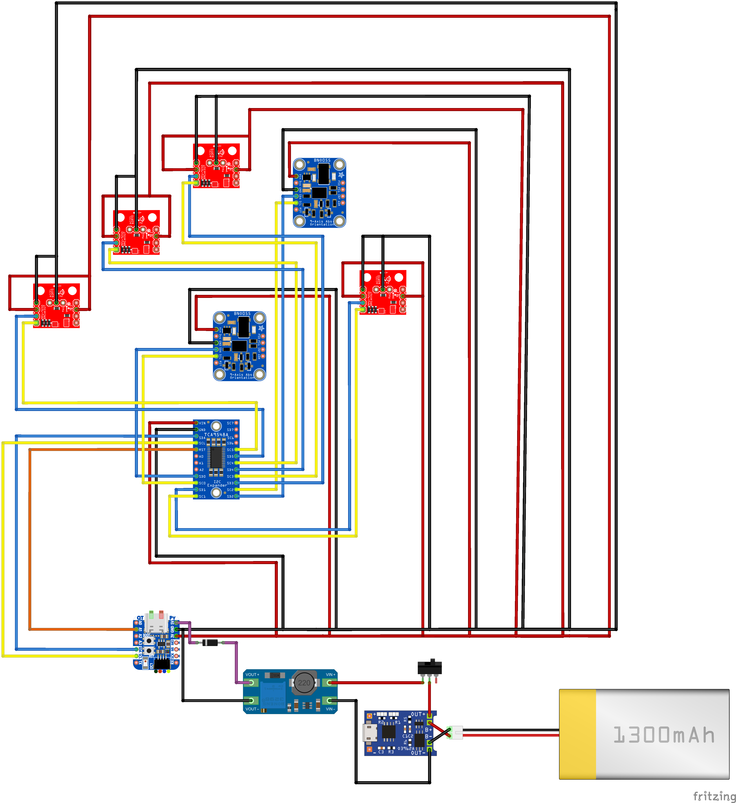

# AirGlove

### Учебный проект по дисциплине «Встроенные системы»

AirGlove - беспроводная перчатка для управления компьютером при помощи движений кисти и пальцев.

## Авторы

- Целиков Даниил Александрович
- Тарасов Владислав Павлович

Группа: **P3319**

## Компоненты

- ESP32-C3 - микроконтроллер.
- 2 × BNO055 и 4 × MPU-9250 - датчики движения.
- TCA9548A - мультиплексор I²C.
- Li-Po аккумулятор, TP4056 и MT3608 - питание и зарядка.

## Схема подключения

## Материалы

- [Техническое задание проекта](docs/AirGlove_TZ.docx)
- [Схема](docs/schema.png)
