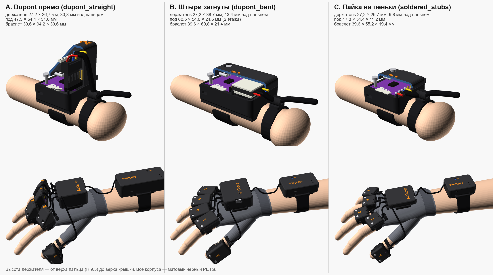
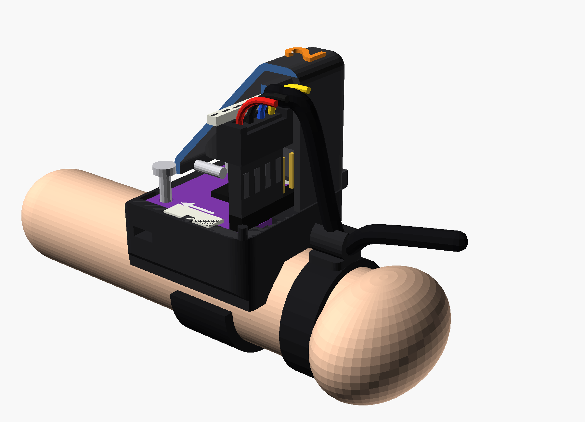
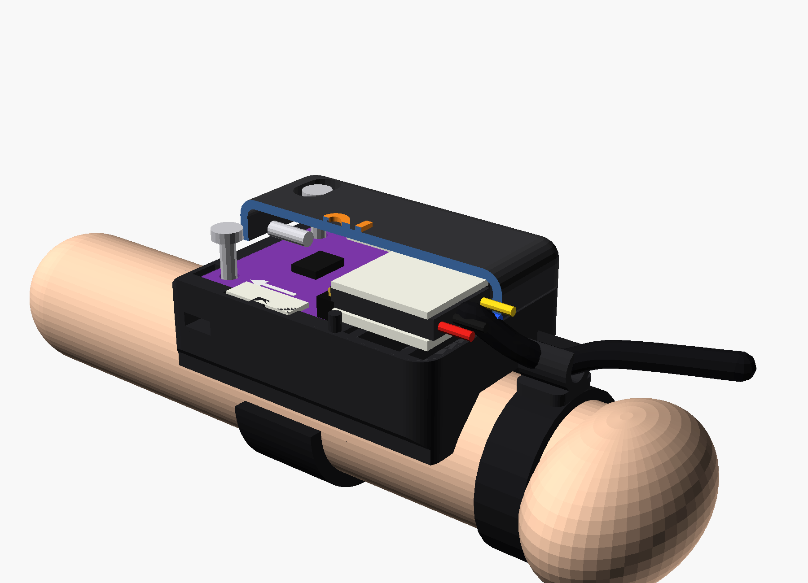
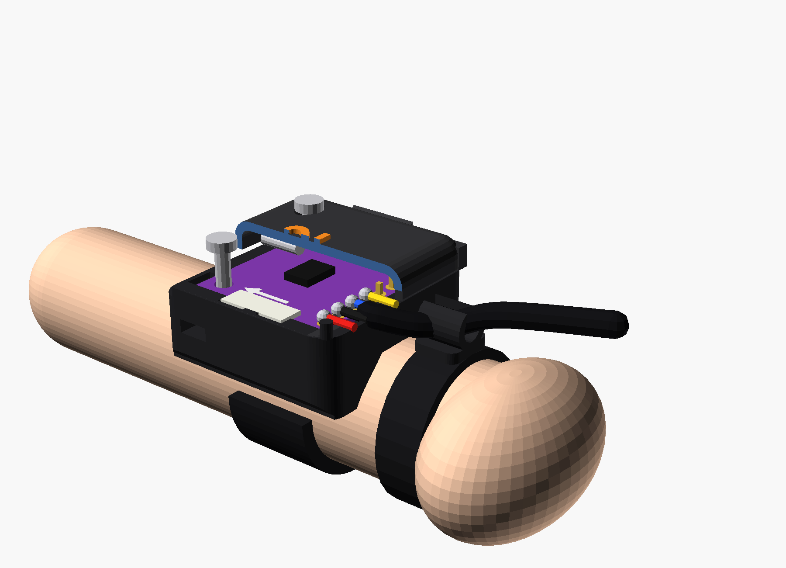
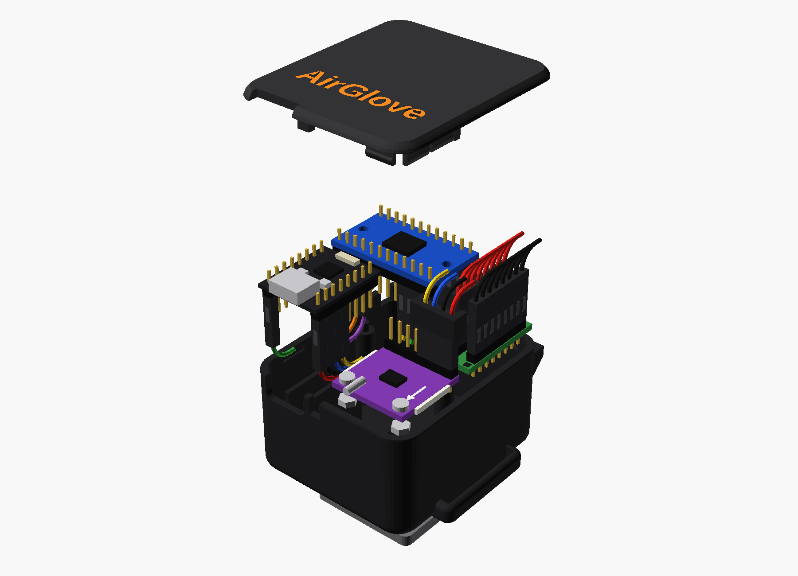
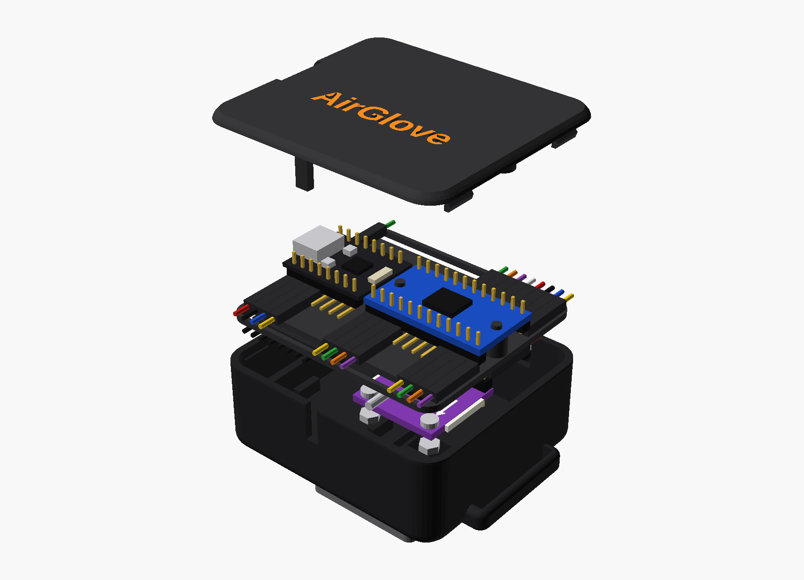
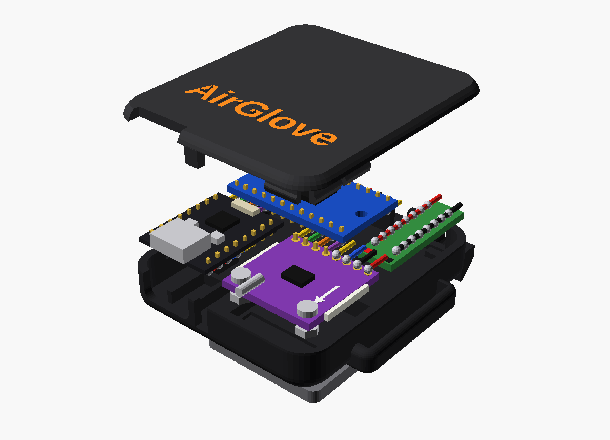
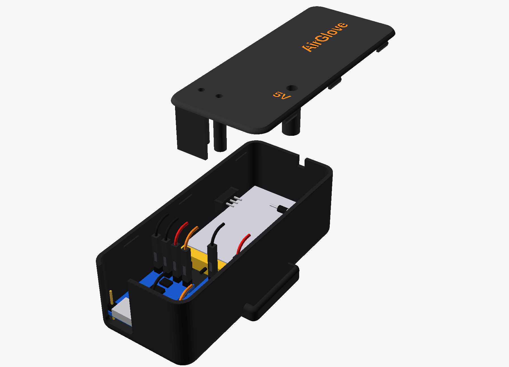
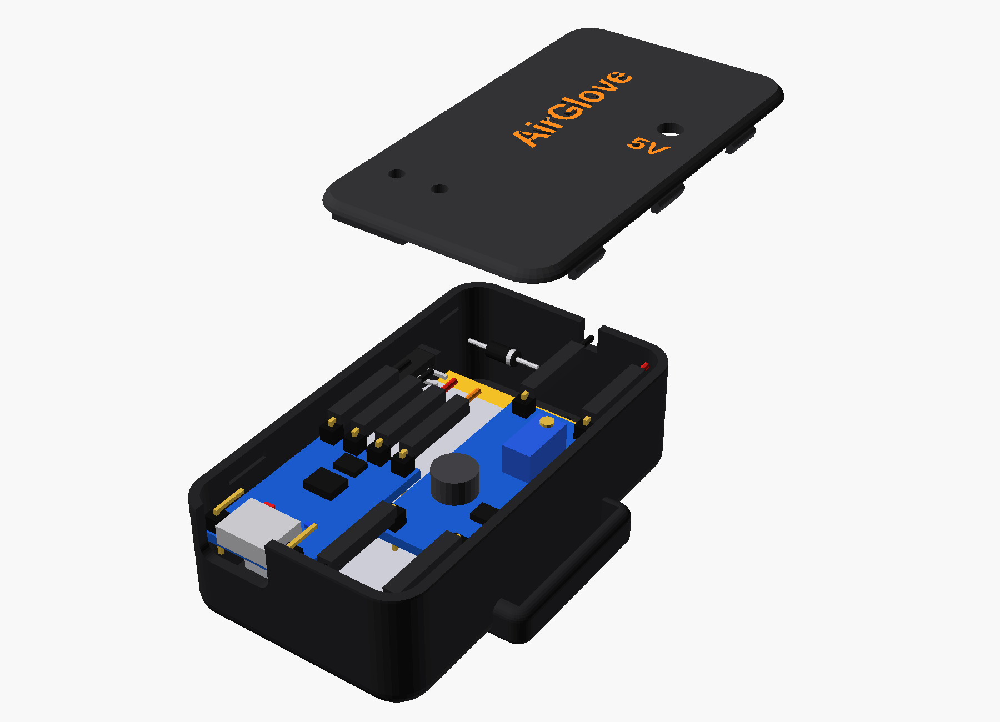
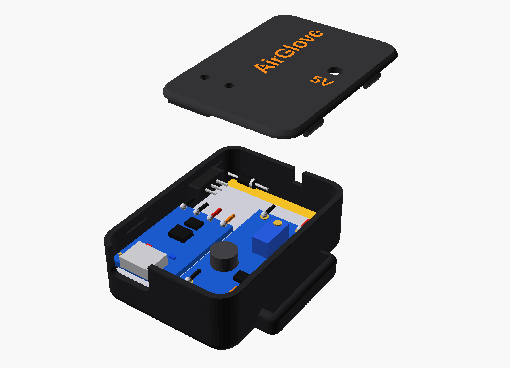

# 3D-модель: корпуса, держатели и посадка на перчатку

Модель сделана в OpenSCAD и полностью параметрическая: размеры плат, гребёнок, разъёмов, пальцев и допусков вынесены
переменными в начало файлов. Исходники лежат в [../tools/model](../tools/model), готовые STL и картинки — в
[model](model), по папке на каждый способ подключения.

**Главное решение — что делать с заводскими гребёнками штырей.** Модель поддерживает три способа, и все детали
(держатели на пальцах, под, коробка питания) и все модули с гребёнками (6 × BNO055, ESP32-C3, TCA9548A, P1, TP4056,
MT3608) перестраиваются одним переключателем `conn_mode` в `tools/model/common.scad`:

| Код | `conn_mode` | Что делаем с гребёнкой | Папка с файлами |
|---|---|---|---|
| **A** | `dupont_straight` | ничего: гнёзда Dupont надеты на штыри вертикально | [model/dupont_straight](model/dupont_straight) |
| **B** | `dupont_bent` | штыри загнуты плоскогубцами на 90° у планки (без пайки), гнёзда лежат плашмя | [model/dupont_bent](model/dupont_bent) |
| **C** | `soldered_stubs` | планка снята, штыри обкусаны до пеньков 1,5 мм, провода припаяны | [model/soldered_stubs](model/soldered_stubs) |

Во всех трёх режимах сохраняются: посадка датчика с допусками (карман +0,8 мм на сторону и 6 пружинящих язычков),
винты M2×10 в плавающих гайках (паз ±1,2 мм), прижимная крышка, тестовая рамка `fit_gauge`, а также параметры
ориентации гребёнок `esp_pins_up`, `tca_pins_up` (`pod.scad`), `tp_pins_up`, `mt_pins_up` (`wrist_box.scad`).
Режим можно задать и отдельно для каждой детали: `fm_mode` (держатель), `pod_mode` (под), `wb_mode` (браслет) —
например, держатели в режиме B, а под в режиме A.



## Три способа подключения

| | **A. Dupont прямо** | **B. Штыри загнуты** | **C. Пайка на пеньки** |
|---|---|---|---|
| Держатель на пальце, Д × Ш | 26,7 × 27,2 мм | **38,7** × 27,2 мм | 26,7 × 27,2 мм |
| Высота над верхом пальца | **30,8 мм** | 13,4 мм | **9,8 мм** |
| Под, Ш × Д × В | 47,3 × 54,4 × 31,0 мм | **60,5** × 54,0 × 24,6 мм, 2 этажа | 47,3 × 54,4 × **11,2** мм |
| Коробка питания, Ш × Д × В | 39,6 × **94,2** × 30,6 мм | 39,6 × 69,8 × 21,4 мм | 39,6 × 55,2 × 19,4 мм |
| Печатные детали, всего | ≈ 89 г | ≈ 88 г | ≈ 49 г |
| **Масса без перчатки** (предел ТЗ 160 г) | **≈ 185 г** | **≈ 184 г** | **≈ 133 г** |
| С перчаткой 25–40 г | 210–225 г | 209–224 г | 158–173 г |
| Пайка | нет | нет | да, ~70 точек: 6 × 4 на датчиках, ~37 в поде, 8 в браслете |
| Инструмент | — | плоскогубцы, шаблон `pin_bend_jig` | бокорезы, паяльник, шаблон `pin_cut_jig`, термоусадка |
| Что можно переделать потом | всё: гнёзда снимаются | гнёзда снимаются; штыри можно разогнуть 1–2 раза | только перепайкой |
| Главный риск | высокие колпаки цепляются и бьются о соседние, под высокий | штырь ломается при повторном сгибе; держатели длиннее и на мизинце/большом заходят на сустав; под шире | перегрев датчика при пайке, провод отрывается у пенька без разгрузки |

Цифры масс посчитаны по объёму STL (PETG 1,27 г/см³ × 0,85 на заполнение) плюс электроника и расходники
(раздел «Бюджет массы»); точную массу покажет слайсер и весы.

**Вывод:** в предел 160 г без перчатки укладывается только C (с перчаткой — на грани). B по массе почти не выигрывает
у A: держатели в 2,3 раза ниже, но на 12 мм длиннее, а под двухэтажный и шире; выигрыш B — высота (меньше цепляется,
меньше рычаг на палец), а не масса. Оценка массы грубая (коэффициент 0,85 завышает массу толстых деталей при
заполнении 20 %), реальные A и B, скорее всего, на 10–20 г легче — но всё равно больше 160 г, поэтому для A и B нужны
меры из раздела «Бюджет массы» (лёгкий аккумулятор и т. д.).

## Что делать в лабе

1. **Осмотрите платы.** У всех ли BNO055 гребёнка уже впаяна? Штырями вверх (со стороны чипа)? У ESP32-C3 и TCA9548A —
   штырями вверх или вниз? У TP4056 и MT3608 — какие контакты со штырями и куда смотрят штыри? Запишите в
   `esp_pins_up`, `tca_pins_up`, `tp_pins_up`, `mt_pins_up`.
2. **Выберите режим:**
   - паять нельзя или не хочется, масса не критична, нужна максимальная ремонтопригодность → **A**;
   - паять нельзя, но держатели должны быть низкими (не цепляются, не бьются друг о друга) → **B** (проверьте сначала
     на одном запасном штыре, что он выдерживает загиб: у дешёвых гребёнок штырь иногда трескается у планки);
     для массы B даёт мало — понадобится лёгкий аккумулятор;
   - паять можно, нужна самая низкая и лёгкая перчатка и предел 160 г → **C**;
   - можно смешивать: держатели в B или C, под в A (`pod_mode`), браслет в любом (`wb_mode`).
3. **Измерьте** всё по списку «Что измерить перед печатью» и поправьте `common.scad`.
4. **Печатайте по порядку:**
   1. `fit_gauge.stl` (~10 мин) — плата ложится в углубление, винты M2 проходят в пазы. Если нет — правим `bno_*`.
   2. **один** `finger_mount.stl` + `finger_cover_2.stl` — собрать на указательном пальце, 30 сгибов, кулак.
   3. в режимах B и C — шаблон (`pin_bend_jig.stl` / `pin_cut_jig.stl`) и подготовка одного датчика;
   4. остальные держатели (`finger_mount.stl` ×2, `_pinky`, `_thumb`, крышки `finger_cover_1…5`);
   5. под (`pod_base`, `pod_lid`, в режиме B ещё `pod_deck`) и коробка питания (`wrist_box`, `wrist_box_lid`).
5. Если первый держатель не сел — сначала меняйте размеры платы и пальца, допуски (`pcb_clear`, `spr_*`) не трогайте.

## Детали и файлы

Все STL лежат в `docs/model/<режим>/stl/`, уже повёрнуты как печатать, всё печатается без поддержек.

| Деталь | Файл | Сколько | Где стоит |
|---|---|---|---|
| Держатель, основание | `finger_mount.stl` | 3 | основные фаланги указательного, среднего, безымянного (R 9,5) |
| Держатель мизинца | `finger_mount_pinky.stl` | 1 | основная фаланга мизинца (R 8,5) |
| Держатель большого пальца | `finger_mount_thumb.stl` | 1 | ногтевая фаланга большого (R 10) |
| Крышка держателя с номером | `finger_cover_1.stl` … `finger_cover_5.stl` | по 1 | 1 — большой, 2 — указательный, 3 — средний, 4 — безымянный, 5 — мизинец (= канал TCA) |
| Тестовая рамка | `fit_gauge.stl` | 1 | проверка посадки платы (~10 мин) |
| Под, основание и крышка | `pod_base.stl`, `pod_lid.stl` | 1 + 1 | тыл кисти, на липучке 30×30 мм |
| Коробка питания и крышка | `wrist_box.stl`, `wrist_box_lid.stl` | 1 + 1 | предплечье, ремешок 25 мм |
| A: насадка на разъём | `dupont_sleeve.stl` | 6 | на 4-контактном гнезде каждого датчика |
| B: палуба пода | `pod_deck.stl` | 1 | второй этаж пода: ESP32-C3 и TCA9548A |
| B: шаблон гибки | `pin_bend_jig.stl` | 1 | пластина 0,6 мм: все штыри гнутся на одной высоте |
| C: шаблон обрезки | `pin_cut_jig.stl` | 1 | пластина 1,5 мм: пеньки одной длины |

Картинки каждого режима: `assembly_persp.png` (рука в сборе), `assembly_top.png` (сверху), `finger_closeup.png`
(держатель, крышка разрезана), `pod_exploded.png`, `wrist_box_exploded.png`.

Все печатные детали — **матовый чёрный PETG**, кромки скруглены 2–3 мм. Номера пальцев на крышках держателей выпуклые
(0,6 мм), надписи на крышках пода и браслета углублены на 0,5 мм (эти крышки печатаются верхом на столе) — их можно
затереть светлой краской или напечатать первые слои другим цветом.

### Держатель на пальце

| A | B | C |
|---|---|---|
|  |  |  |

Общее для всех режимов:

- **Ставится на основную фалангу**, на большом пальце — на ногтевую. Плата (WCMCU-055, 21,0 × 20,5 мм) лежит чипом
  вверх, **рядом контактов к кисти**, ось X шелкографии — к кончику пальца.
- **Основание:** седло-«капля» (печатается без поддержек), канал ленты-липучки 12 мм. Карман на 0,8 мм на сторону
  больше платы, 6 пружинящих язычков центруют плату. Под рядом контактов — выемка под хвосты штырей на всю ширину,
  вдоль края с отверстиями — выемка 0,8 мм под выводы кварца. Две гайки M2 вставляются сбоку в каналы и едут по X
  на ±1,2 мм.
- **Крышка:** «мыльная», кромки скруглены 2,5 мм, сверху выпуклый номер пальца. Садится на стенки основания (два штифта
  Ø1,5), держится **2 винтами M2×10** через отверстия платы; полки по длинным краям прижимают плату через вспененный
  скотч 1 мм. Если крыша выше посадки головки винта, головка уходит в колодец Ø4,4 — поэтому винт везде M2×10.
- На кольце-фиксаторе (лента 6 мм) за держателем — **клипса для кабеля**: жгут защёлкивается в неё и не тянет разъём.

Отличия:

- **A (`dupont_straight`)** — на VCC–GND–ATX–LRX надет 4-контактный корпус Dupont с насадкой `dupont_sleeve`.
  Над разъёмом крышка поднимается гладкой «горкой» до 30,8 мм над пальцем (над платой у кончика — 11,8 мм).
  Перемычка горки через EVA 2 мм прижимает насадку — гнездо не снимется. Провода выходят к кисти через окно,
  стяжка 2,5 мм через две прорези прижимает жгут к крышке.
- **B (`dupont_bent`)** — все 8 штырей загнуты к кисти на 0,6 мм выше планки (шаблон `pin_bend_jig`), 4-контактный
  корпус лежит плашмя на «лотке» — продолжении основания к кисти — между двумя полосками EVA 1 мм. Держатель на
  12 мм длиннее (38,7 мм) и всего 13,4 мм высотой. Окно в торце уже корпуса (9,3 против 10,2 мм): при рывке корпус
  упирается в торец, тянуть его со штырей нечем.
- **C (`soldered_stubs`)** — планка снята, штыри обкусаны до 1,5 мм (шаблон `pin_cut_jig`), хвосты снизу — до 1 мм.
  Провода припаяны к пенькам и уложены плашмя к кисти. Крышка плоская, 9,8 мм над пальцем (её высоту задаёт кварц
  до 3 мм). Жгут прижат к крышке стяжкой через две прорези.
- ⚠ **Лесенка.** Держатели шире пальца (27,2 мм против шага пальцев ~20 мм), поэтому в A и C указательный и
  безымянный стоят ближе к костяшкам, средний и мизинец — на ~10 мм дальше. В B держатели длинные, лесенки не
  получается: центр платы ставится не ближе 26 мм к суставу (иначе лоток заходит на костяшку), а на мизинце и
  большом пальце лоток всё равно немного заходит на сустав. При сведённых пальцах борта соседних держателей касаются
  во всех режимах; в B и C они низкие, поэтому мешают меньше.

### Почему подойдёт при любых допусках

Держатель не «облегает» плату, а принимает целый диапазон размеров; крепление — через отверстия платы винтами с
запасом хода. Одинаково для A, B и C:

| Что гуляет | Номинал | Принимается | Чем компенсируется |
|---|---|---|---|
| Размер платы поперёк пальца | 21,0 | 19,4 … 22,6 мм (центрируется пружинами от 20,6) | зазор кармана 0,8 мм/сторону + язычки с ходом 1,2 мм |
| Размер платы вдоль пальца | 20,5 | 18,9 … 22,1 мм | то же |
| Межцентровое расстояние отверстий | 16,0 | 13,6 … 18,4 мм | пазы ±1,2 мм по X в крышке и основании, гайка едет в канале |
| Отступ отверстий от края | 2,5 | 1,7 … 3,3 мм | плата сдвигается в кармане, пружины подстраиваются |
| Толщина платы | 1,6 | 1,2 … 2,0 мм | крышка упирается в основание, полки прижимают через пену 1 мм |
| Хвосты штырей под платой | 3,0 (C: 1,0) | до 4,0 (C: до 2,0) | выемка хвост + 1 мм |
| A: высота «планка + гнездо» | 16,5 | 15,9 … 17,3 мм | EVA 2 мм под перемычкой горки |
| B: высота загнутого штыря над платой | 3,1 | 2,7 … 3,6 мм | EVA 1 мм под корпусом и 0,8 мм над ним |
| Кварц | Ø2×6 у отверстия | до 3 мм над платой | крыша над платой на 3,6 мм, передняя стенка ниже платы |

Числа — переменные в начале `finger_mount.scad` (`pcb_clear`, `spr_*`, `hole_fx`, `pcb_t_min/max`, `tail_extra`,
`comp_clear`, `foam_*`). Если рамка показала, что плата другая, — поменяйте `bno_a`, `bno_b`, `bno_hole_in` в
`common.scad`, допуски трогать не нужно.

### Под (корпус на тыле кисти)

| A | B | C |
|---|---|---|
|  |  |  |

- **Форма «как у часов»:** углы R6, нижняя кромка скруглена 3 мм, верхняя 2,5 мм (скругление целиком в крышке),
  на крышке логотип «AirGlove». Стенки 1,8, дно 1,6, крышка 2,0. По бокам ушки под необязательный ремешок 20–25 мм.
- **Кабели:** 4 прорези в стенке пальцев, 1 в стенке большого пальца, 1 (3,4 мм) в стенке запястья для 5V/GND.
  Снаружи стенки пальцев — **гребёнка для кабелей** с 45°-подпоркой: 4 кабеля лежат в своих выемках. Зубья крышки
  прижимают кабели в прорезях — это разгрузка.
- **Датчик ладони U1** — в гнезде с той же логикой допусков: карман +0,8 мм на сторону (центрируют полоски скотча 1 мм),
  выемка под хвосты, ниша в стенке запястья под кварц, 2 винта **M2×6** в гайки, вставленные снизу в пазы (±1,2 мм по X,
  потом закрываются липучкой). Датчик повёрнут **рядом контактов к пальцам**, поэтому **ось X датчика ладони смотрит
  к запястью** — учтите в прошивке.
- **A:** один этаж, как раньше. ESP32-C3 у стенки большого пальца и запястья, штырями вниз на высоких рёбрах, USB-C
  к запястью; TCA9548A у стенки пальцев штырями вниз на стойках со штифтами; P1 у стенки мизинца штырями вверх.
  Насадку разъёма датчика ладони прижимает ребро крышки через EVA 2 мм.
- **B:** около 37 лежачих гнёзд не помещаются в один этаж на тыле кисти (одноэтажный вариант выходит ~75 × 90 мм),
  поэтому под **двухэтажный**. Внизу — датчик ладони и P1 (поперёк, гнёзда к ±Y); на них лежит съёмная **палуба**
  `pod_deck.stl` (на полках вдоль стенок ±X), она же прижимает лежачее гнездо датчика ладони. На палубе — ESP32-C3
  (повёрнута, **USB-C к стенке большого пальца**) и TCA9548A, их гнёзда лежат на палубе к ±Y. Провода к нижнему этажу
  идут через прорези палубы у торцов.
- **C:** раскладка как в A, но всё низкое: под 11,2 мм. Провода припаяны и уложены плашмя к прорезям.
- Если ESP или TCA у вас штырями вверх, поставьте `esp_pins_up = true` / `tca_pins_up = true`: высота меняется
  мало (см. расчёт).
- ⚠ Назначение 24 контактов TCA9548A в модели — предположение. Сверьте с надписями: на геометрию это не влияет.

### Коробка питания на браслете

| A | B | C |
|---|---|---|
|  |  |  |

- У **TP4056 Type-C и MT3608 стоит заводская гребёнка 2,54 мм** (одиночные штыри на площадках), выпаивать её не
  будем. Используются TP4056: **B+, B−, OUT+, OUT−** (IN± свободны, штыри остаются); MT3608: **VIN+, VIN−, VOUT+,
  VOUT−**. В режимах A и B на них надеты 8 одиночных гнёзд Dupont, в C провода припаяны к пенькам.
- Ориентация гребёнок — `tp_pins_up` и `mt_pins_up` (по умолчанию **штырями вверх**); коробка рассчитана на любое
  сочетание. Модель сама проверяет, что крышка не задевает корпуса гнёзд (`assert`), и печатает габарит (`echo`).
- **A — аккумулятор РЯДОМ с модулями** (вдоль руки): у локтя TP4056 (USB-C в торец) и MT3608 на печатных
  пьедесталах, к кисти — аккумулятор, выводами к модулям. Аккумулятор под модулями тут не годится: при штырях вниз
  модули стоят на гнёздах высотой 22 мм, и даже при штырях вверх коробка вышла бы 39,6 × 57,2 × 37,6 мм — выше,
  чем шире. Над аккумулятором остаётся место для тумблера, диода, изгибов проводов и запаса. Провода с OUT/B
  уходят к аккумулятору, с VIN — над самой MT3608 (подстроечник остаётся свободным), с VOUT — к аккумулятору.
  При штырях вниз пьедестал становится рамкой 22 мм, провода загибаются под платой.
- **B и C — два этажа:** аккумулятор на дне, модули над ним на прокладках EVA (3 мм в B, 1 мм в C), чтобы хвосты штырей
  не давили на аккумулятор. В B гнёзда TP4056 лежат к кисти, гнёзда MT3608 — к обоим торцам (над модулем мешают
  дроссель и подстроечник), отсюда длина 69,8 мм.
- **Подстроечник MT3608** — под отверстием Ø4 в крышке с трубкой-направляющей до самого подстроечника (отвёртка не
  заденет провода), рядом надпись «5V». Над светодиодами TP4056 — окошки Ø2,5 с короткими трубками-световодами.
- **USB-C TP4056** — в торце со стороны локтя, окно 12,5 × 7,2 мм открыто сверху, его закрывает зуб крышки.
- **Тумблер SS12D00** — в держателе на стенке большого пальца, над аккумулятором, вне зоны ремешка. Диод 1N5819 — на
  проводе в термоусадке. **Кабель 5V/GND** к поду выходит в торце со стороны кисти через прорезь с зубом-прижимом.
- Ушки под **ремешок 25 мм** посередине длины, коробка надевается **выше манжеты перчатки**, торец у кисти — в ~45 мм от
  складки запястья. Форма как у пода: скруглённое дно 3 мм, скруглённый верх 2 мм.

## Расчёт: всё ли влезает

Все числа считает сама модель (`echo` при рендере каждого файла), здесь — та же арифметика руками. Номиналы:
планка гребёнки 2,5, штырь над планкой 6,0, хвост 3,0, корпус Dupont 14,0 × 2,54, изгиб провода R5 (+ 0,55);
в B ось загнутого штыря 3,1 мм над платой, корпус лежит от 0,8 до 14,8 мм от ряда, ещё 2 мм — выход провода;
в C пенёк 1,5 мм + капля припоя с проводом = 2,5 мм над платой, хвост снизу 1,0.

### Держатель на пальце (палец R 9,5)

Поперёк пальца во всех режимах: `плата 21,0 + 2 × 0,8 = карман 22,6;  + 2 × стенка с язычком 2,3 = 27,2 мм`.
Вдоль пальца: `20,5 + 2 × 0,8 + 2 × 2,3 = 26,7 мм` (A, C).

```
                         A (прямо)          B (загнуто)            C (пеньки)
седло 0,3 + 0,3 + дно 0,8   1,4                1,4                    1,4
выемка под хвосты           3,0 + 1 = 4,0      4,0                    1,0 + 1 = 2,0
= низ платы                 5,4                5,4                    3,4
+ плата 1,6                 7,0                7,0                    5,0  верх платы
разъём над платой           +2,5 +14 = 23,5    ось +3,1 = 10,1;       пенёк+провод +2,5 = 7,5
                            изгиб +5,55 = 29,05  верх корп. +1,27 = 11,37
крыша над кварцем (+3,6)    10,6               10,6                   8,6
потолок                     29,05 + 0,5 = 29,55 max(10,6; 11,37 + EVA 0,8) = 12,17   8,6
+ крыша 1,2                 30,75              13,37                  9,8   верх держателя над пальцем
```

Длина в режиме B: от центра платы к кисти `ряд 8,95 + 0,8 + корпус 14,0 + 0,4 + торец 1,2 = 25,35`, к кончику 13,35 —
всего **38,7 мм** (основная фаланга 37–47 мм: на указательном, среднем и безымянном помещается целиком).
Винт во всех режимах M2×10: головка садится на уровень `верх платы + 3,6 + 1,2`; в B — в колодце глубиной 1,6 мм.

### Под

```
A: ESP штырями вниз: дно 1,6 + изгиб 5,55 + Dupont 14,0 + планка 2,5 = 23,65;  + 1,0 + USB-C 3,3       = 27,95
   TCA штырями вниз: 23,65 + 1,6 + хвосты 3,0                                                    = 28,25
   P1 вверх:  1,6 + 3,3 = 4,9;  + 1,6 + 22,05                                                     = 28,55  ← максимум
   датчик ладони: 0,8 + 4,0 = 4,8;  + 1,6 + 22,05                                                 = 28,45
   низ крышки 28,55 + 0,45 = 29,0;  + крышка 2,0 = 31,0;   план 43,7 + 2 × 1,8 = 47,3;  50,8 + 3,6 = 54,4

B: этаж 1: датчик ладони 4,8 + 1,6 + 4,37 + 0,3 = 11,07;  P1 4,9 + 1,6 + 4,37 = 10,87
   палуба: низ 11,07 + 0,3 = 11,37, верх 11,37 + 1,6 = 12,97
   ESP штырями вниз: 12,97 + 0,2 + 1,27 + 3,1 = 17,54;  + 1,0 + USB-C 3,3                         = 21,84
   TCA штырями вниз: 17,54 + 1,6 + хвосты 3,0                                                     = 22,14  ← максимум
   низ крышки 22,59;  + 2,0 = 24,6
   план X: 1,4 + ESP 22,5 + 1,5 + TCA 31,0 + 0,5 = 56,9 + 3,6 = 60,5
        Y: ряды TCA ±7,62 + лежачие гнёзда 16,8 с каждой стороны = 48,8 + 1,6 = 50,4 + 3,6 = 54,0

C: ESP штырями вниз: 1,6 + 2,5 + 0,3 = 4,4;  + 1,0 + USB-C 3,3                                   = 8,7   ← максимум
   TCA: 4,4 + 1,6 + 1,5 = 7,5;  P1: 1,6 + 1,3 = 2,9 + 1,6 + 2,8 = 7,3;  датчик: 0,8 + 2,0 + 1,6 + 3,3 = 7,7
   низ крышки 9,15;  + 2,0 = 11,15;  план как в A: 47,3 × 54,4
```

### Коробка питания

Аккумулятор 34 × 50 × 6,5, отсек 7,0 мм; ширина везде `36,4 (АКБ 34 + 2,4; модули 0,5 + 17 + 1,4 + 17 + 0,5) + 2 × 1,6 = 39,6`.

```
A, аккумулятор рядом, штырями вверх:
   дно 1,6 + хвосты 3,0 + 0,3 = 4,9 низ модуля (пьедестал 2,5 + пена 0,8)
   + плата 1,6 + планка 2,5 + Dupont 14,0 + изгиб 5,55 = 28,55;  + 0,45 = 29,0 низ крышки;  + 1,6 = 30,6
   штырями вниз (MT3608): 1,6 + 5,55 + 14,0 + 2,5 + 0,2 = 23,85;  + 1,6 + подстроечник 5,4 = 30,85 → 32,9 общая
   длина: MT3608 0,5 + 36,0 + выводы АКБ 3,5 + АКБ 50,0 + 1,0 = 91,0 внутри;  + 3,2 = 94,2

B, аккумулятор внизу: дно 1,6 + отсек 7,0 = 8,6;  + EVA 3,3 = 11,9 низ модулей
   MT3608: + 1,6 + подстроечник 5,4 = 18,9;  USB-C TP4056 со штекером: 11,9 + 1,6 + 1,6 + 3,6 + 0,6 = 19,3
   низ крышки 19,3 + 0,45 = 19,75;  + 1,6 = 21,35
   длина: гнёзда MT3608 к обоим торцам: 2 × (0,5 + 16,0 + 16,8) = 66,6 внутри;  + 3,2 = 69,8

C, аккумулятор внизу: 8,6 + хвосты 1,0 + 0,3 = 9,9;  USB-C: 9,9 + 1,6 + 1,6 + 3,6 + 0,6 = 17,3 → 17,75;  + 1,6 = 19,35
   длина: по аккумулятору 50 + 2 = 52 внутри;  + 3,2 = 55,2
```

## Как крепим датчик

Шаг 0 — один раз, до печати остальных держателей: тестовая рамка `fit_gauge.stl` (27,2 × 26,7 × 1,2 мм). Положите
плату гребёнкой вверх: она должна лечь в углубление, хвосты — в окно, стрелка рамки — туда же, куда ось X платы,
винты M2 — пройти в пазы. Если нет — измерьте плату и поправьте `bno_a`, `bno_b`, `bno_hole_in`, `bno_pin_in`.

**Подготовка платы по режиму:**

- **A:** наденьте 4-контактный корпус Dupont на **VCC, GND, ATX, LRX** (красный, чёрный, синий, жёлтый) и насадку
  `dupont_sleeve` сверху, проводами в прорезь со стороны кисти.
- **B:** наденьте `pin_bend_jig` на все 8 штырей до планки (ребро-ручка — со стороны кончика), плоскогубцами загните
  штыри **к кисти** через край шаблона, снимите шаблон. Гните один раз, не разгибайте. Наденьте 4-контактный корпус на
  VCC…LRX плашмя, до упора.
- **C:** снимите планку (поддеть отвёрткой), положите `pin_cut_jig` на плату, обкусите штыри заподлицо с шаблоном
  (пеньки 1,5 мм), хвосты снизу — до 1 мм. Залудите пеньки, припаяйте 4 провода (VCC, GND, ATX, LRX) сбоку,
  уложите их плашмя к кисти, на каждый — термоусадка 1,5 мм. Паяльник не дольше 3 с на точку.

**Дальше одинаково:**

1. **Гайки** M2 — сбоку в два канала основания.
2. **Пена:** вспененный скотч 1 мм на прижимные полки крышки. A — полоска EVA 2 мм под перемычку горки;
   B — полоска EVA 1 мм на лоток и ещё одна на потолок крышки над корпусом.
3. **Плата в карман:** чипом вверх, **рядом контактов к кисти**, ось X к кончику. Язычки сами отцентруют плату.
4. **Крышка** сверху: провода — в окно торца у кисти, штифты основания — в отверстия крышки. Номер на крышке =
   номер пальца (1 — большой … 5 — мизинец).
5. **Винты** M2×10 через пазы крышки и отверстия платы в гайки, до упора крышки, без силы.
6. **Стяжка** (A и C): 2,5 мм вниз через одну прорезь, под жгутом, вверх через другую. В B жгут держит торец.
7. **На палец:** лента-липучка 12 мм через канал под карманом, держатель на основную фалангу. Кольцо-фиксатор 6 мм
   с клипсой — в 7 мм за держателем, жгут защёлкнуть в клипсу.
8. **Кабель** к поду с петлёй-запасом над костяшкой.

Снять датчик: клипса → стяжка → 2 винта → крышка → плата.

## Что и как печатать

| Деталь | Материал | Слой | Стенки | Заполнение | Ориентация | Поддержки |
|---|---|---|---|---|---|---|
| fit_gauge, шаблоны | любой | 0,2 | 2 | 100 % | плоско | нет |
| finger_mount ×3, _pinky, _thumb | PETG чёрный матовый | 0,2 | 3 | 20 % gyroid | «щёками» вниз (как в STL) | нет |
| finger_cover_1…5 | PETG | 0,2 | 3 | 20 % | бортами на стол; крыша — мост ≤ 25 мм | нет |
| dupont_sleeve ×6 (A) | PETG | 0,12–0,16 | 2 | 100 % | губкой на стол | нет |
| pod_base, wrist_box | PETG | 0,2 | 3, низ/верх 5 слоёв | 20 % | дном на стол | нет |
| pod_lid, wrist_box_lid | PETG | 0,2 | 3 | 20 % | верхом на стол | нет |
| pod_deck (B) | PETG | 0,2 | 3 | 20 % | плоско | нет |

- **PETG** лучше PLA: PLA размягчается около 55 °C, защёлки и язычки из него трескаются. Для примерки PLA подойдёт.
  Матовая поверхность — пруток «PETG matte» или текстурный стол.
- Язычки в кармане тонкие (0,8 мм): сопло 0,4, ширина линии 0,4, проверьте в слайсере, что они не пропали.
- Нижние кромки пода и браслета скруглены «каплей» (скругление переходит в фаску 45° у стола) — печатаются без
  поддержек. Крышка держателя в A печатается с наклонным потолком горки (уклон ≤ 60°) — включите мосты.

## Что купить для монтажа

| Что | Сколько | Режим | Зачем |
|---|---|---|---|
| Провода Dupont «мама–мама» 20 см или корпуса 1-pin и 4-pin + контакты | шлейф 40 шт. + 6 корпусов 4-pin | A, B | кабели датчиков и перемычки в поде и браслете |
| Провод силиконовый 28–30 AWG, 4 цвета | 5 м | C (и A, B для кабелей) | кабели датчиков |
| Паяльник, флюс, припой, термоусадка 1,5 мм | — | C | пайка к пенькам |
| Плоскогубцы с тонкими губками | 1 | B | гибка штырей |
| Бокорезы | 1 | C | обрезка штырей |
| Винты M2×10 | 10 + запас | все | держатели: 2 на палец |
| Винты M2×6 | 2 | все | датчик ладони в поде |
| Гайки M2 | 12 + запас | все | держатели и под |
| Вспененный двусторонний скотч 1 мм | 0,5 м | все | полки крышек, стенки кармана, модули |
| EVA/неопрен 1–3 мм | лист A5 | все | прокладки под разъёмы, под модули в браслете, под коробку |
| Стяжки 2,5 мм | 10 | A, C | жгут к крышке держателя |
| Липучка 30×30 мм | 1 пара (+1) | все | под на перчатке |
| Лента-липучка 12 мм | 1 м | все | кольца на пальцы (5 × 8–10 см) |
| Лента-липучка 6 мм | 0,5 м | все | кольца-фиксаторы с клипсами |
| Ремешок-липучка 25 мм | 0,5 м | все | браслет |
| Оплётка кабельная чёрная 3 мм | 3 м | все | кабели пальцев и питания |
| Каптоновый скотч | 1 рулон | все | изоляция аккумулятора |

## Как вести кабели

- **У датчика** жгут выходит из крышки к кисти и прижат стяжкой (A, C) или держится упором корпуса в торец (B) —
  жёсткая точка №1. Сразу за держателем — **клипса на кольце-фиксаторе**.
- **Над суставами** — петля-запас (15–20 мм на сустав): метки маркером на выпрямленной руке и в кулаке, разница + 1–2 см.
- **По перчатке** — в чёрной оплётке 3 мм, через скользящие петли из нитки каждые 2–3 см, не клеить.
- **У пода** кабели ложатся в **гребёнку** и в свою прорезь, зуб крышки прижимает их — жёсткая точка №2. Внутри:
  VCC/GND на P1, ATX/LRX на свой канал TCA (в B — через прорези палубы).
- **Кабель питания** выходит из браслета через прорезь с зубом; над сгибом запястья петля-запас 3–4 см.

## Порядок сборки

1. Тестовая рамка, один держатель на указательном — см. «Что делать в лабе».
2. **Держатели** — по шагам раздела «Как крепим датчик».
3. **Под:** гайки снизу в пазы гнезда датчика ладони, датчик в карман, 2 винта M2×6. Дальше:
   - A и C: ESP32-C3 на рёбра (USB-C в окно запястья), TCA9548A на стойки, P1 на рёбра; в A — насадка на разъём датчика
     ладони и полоска EVA под ребро крышки;
   - B: P1 на рёбра нижнего этажа, все нижние разъёмы; провода к палубе пропустить через её прорези; палубу на полки;
     ESP32-C3 (USB-C к стенке большого пальца) и TCA9548A на палубу.
   Соединить по [connections.md](connections.md), прозвонить (GND не звонится с 3V3 и 5V). Кабели в гребёнку и
   прорези, защёлкнуть крышку. Липучку-«крючки» 30×30 на дно (закрывает гайки).
4. **Перчатка:** центр тыла кисти, край пода в 15–20 мм от складки запястья, **не на костяшках**. Пришить «петлю» 30×30.
5. **Браслет:** A — модули на пьедесталы (пена), аккумулятор в отсек выводами к модулям; B, C — аккумулятор на дно
   (каптон), EVA, модули сверху. Тумблер в держатель. **До подключения пода** выставить MT3608 на 5,0–5,1 В отвёрткой
   через трубку в крышке. Ремешок 25 мм через ушки, EVA снизу.
6. **Надевание:** перчатка → держатели → под на липучку → браслет выше манжеты → кабель питания.
7. **Проверка (ТЗ):** по 30 сгибов каждого пальца, кулак, разведённые пальцы, сгиб кисти.

## Бюджет массы

Печатные детали — объём STL × 1,27 г/см³ × 0,85. Остальное одинаково для всех режимов, кроме разъёмов и гребёнок.

| Узел | A | B | C | Откуда цифра |
|---|---|---|---|---|
| Держатели ×5: основание + крышка (+ насадка в A) | 37,6 | 43,3 | 22,2 | STL |
| Под: основание + крышка (+ палуба в B) | 24,4 | 28,3 | 14,3 | STL |
| Коробка питания + крышка | 26,5 | 16,2 | 12,8 | STL |
| 6 × GY-BNO055 (C — без планки, штыри обкусаны) | 18 | 18 | 16,5 | ~3 г/шт. |
| ESP32-C3 + TCA9548A + P1 | 6,5 | 6,5 | 5,5 | |
| Корпуса Dupont: ~45 одиночных + 6 по 4 | 8 | 8 | 0,5 (припой) | ~0,12 г одиночный |
| Li-Pol 1300 мА·ч (603450) | 25 | 25 | 25 | паспорт ~24–26 г |
| TP4056 + MT3608 + тумблер + диод | 6,5 | 6,5 | 6 | |
| Провода, оплётка, термоусадка, каптон | 12 | 12 | 10 | 28 AWG ≈ 1 г/м × ~5 м + оплётка |
| Липучки, ремешок, EVA, пена, стяжки, клипсы | 17 | 17 | 17 | |
| Винты и гайки M2 (12 + 12) | 3 | 3 | 3 | |
| **Итого без перчатки** | **≈ 185** | **≈ 184** | **≈ 133** | ТЗ: не больше 160 г |
| С перчаткой 25–40 г | 210–225 | 209–224 | 158–173 | |

Чем ещё облегчить (для любого режима): аккумулятор 600–800 мА·ч (602535 / 603040, 12–15 г): −10…−13 г, ток схемы
~190 мА, хватит на ~2,5 ч; держатели и крышки с заполнением 10–15 % и 2 периметрами: −5…−7 г; лёгкая перчатка ≤ 25 г;
смешанный вариант: держатели в C (`fm_mode`), а под и браслет — как удобно. Для A и B без лёгкого аккумулятора и
лёгкой перчатки в 160 г не уложиться.

## Что измерить перед печатью

- [ ] **GY-BNO055** (штангенциркулем): край с рядом контактов → `bno_a` (≈21,0), перпендикулярный край → `bno_b`
      (≈20,5), толщина → `bno_pcb`; диаметр отверстий → `bno_hole_d`, отступ их центров → `bno_hole_in`; от края до
      оси ряда → `bno_pin_in`; где VCC → `bno_pin1_side`; где кварц → `bno_xtal_side`, `bno_xtal_out`. Проверьте
      **тестовой рамкой**.
- [ ] **Гребёнка:** планка → `hdr_spacer` (2,5), штырь над планкой → `hdr_pin_up` (6,0), хвост → `hdr_tail` (3,0).
- [ ] **Режим B:** высота оси загнутого штыря над платой → `bent_z` (3,1); проверьте на одном штыре, что он не
      трескается при загибе.
- [ ] **Режим C:** длина пенька после обрезки → `stub_len` (1,5), хвост → `stub_tail` (1,0).
- [ ] **Корпус Dupont:** длина → `dup_l` (14,0); радиус изгиба вашего провода → `dup_bend_r` (A).
- [ ] **ESP32-C3:** размеры, расстояние между рядами → `esp_row` (15,24), штыри вверх/вниз → `esp_pins_up`, вылет
      USB-C → `esp_usb_out`.
- [ ] **TCA9548A:** размеры, `tca_row`, отверстия → `tca_hole_d`, `tca_hole_in`, штыри → `tca_pins_up`.
- [ ] **P1:** `p1_l` × `p1_w`, хвосты.
- [ ] **TP4056 и MT3608:** размеры; положение штырей → `tp_pin_far_x/y`, `tp_pin_in_x/y`, `mt_pin_x/y`; куда смотрят
      штыри → `tp_pins_up`, `mt_pins_up`; винт подстроечника → `mt_pot_pos`, `mt_screw_dy`.
- [ ] **Штекер USB-C** вашего кабеля (окна 12,5 × 7,2) → `usb_cut_w/usb_cut_h` (под), `usb_w/usb_h` (браслет).
- [ ] **Аккумулятор** → `lipo_l/lipo_w/lipo_t` (модель проверит `assert`).
- [ ] **Обхват фаланг** → `finger_r` (9,5 = 60 мм), `pinky_r` (8,5 = 53 мм), `thumb_r` (10 = 63 мм).
- [ ] **Длина основной фаланги:** A, C — держатель 26,7 мм; **B — 38,7 мм**, проверьте мизинец (37 мм).
- [ ] **Тыл кисти:** ширина ≥ 56 мм (A, C) / **≥ 66 мм (B: под 60,5)**; длина ≥ 75 мм.
- [ ] **Обхват предплечья** в 8–10 см от запястья: ремешок 25 мм = обхват + 8 см; длина коробки A 94 мм вдоль руки.
- [ ] **Толщина лент:** `strap_t` (1,8), `lug_slot` (2,6), `wb_lug_slot` (3,0).

## Какую перчатку купить

Нужна перчатка **без пальцев**, с **липучкой на запястье**, ладонью из искусственной кожи и **нетянущейся тыльной
стороной** (неопрен, искусственная кожа, замша). Кольца с датчиками сидят прямо на пальцах, а капсула держится на
квадрате липучки, поэтому перчатка почти не влияет на показания. Сетка и лайкра на тыльной стороне не годятся:
тянутся, капсула будет ездить.

Цены и наличие ниже взяты из поисковой выдачи (ноябрь 2026), перед заказом проверьте карточку — особенно поле
«Материал».

| Вариант | Где | Цена | Тыльная сторона | Заметки |
|---------|-----|------|-----------------|---------|
| **FUZZ CLASSIC без пальцев** — основной выбор | [Яндекс Маркет](https://market.yandex.ru/category/fuzz-veloperchatki) | ~1000 ₽ | неопрен + искусственная кожа | Липучка на запястье, петли для снятия, размеры S–XL. Брать версию с неопреном, **не лайкровую** |
| **Ifrit KRATOS Рук-602** (тактические без пальцев) | [ВсеИнструменты](https://www.vseinstrumenti.ru/product/perchatki-takticheskie-bez-paltsev-ifrit-kratos-zamsha-nejlon-plastik-chernyj-r-l-ruk-602-l-6855817/) | ~550 ₽ | замша/нейлон | Почти не тянется, плотная манжета. Есть пластиковая накладка на костяшках — капсулу ставить ближе к запястью |
| Тактические/мото без пальцев с маркетплейсов | Ozon / Wildberries | 500–1900 ₽ | разная | Привозят за 1–3 дня. Брать только с искусственной кожей или неопреном, без сетки |

Не подходят: обычные велоперчатки с сеткой или лайкрой сверху, фитнес-перчатки Demix/Athlex (тянутся, по отзывам
отходит липучка). Полнопалые перчатки механика (Mechanix Original и т. п.) допустимы, но тогда кольца сидят поверх
ткани; проще отрезать пальцы до средней фаланги.

**Размер.** Измерьте обхват ладони под костяшками без большого пальца и сверьте с таблицей продавца
(пример: M ≈ 20–21 см, L ≈ 21–22 см). Между размерами — берите меньший: плотнее сидит. По ТЗ нужны две перчатки
соседних размеров — возьмите одну модель в двух размерах (например, M и L); капсула и браслет переставляются
на липучке.

**Расходники для крепления** (где быстро купить):

- липучка 20–25 мм пришивная + самоклеящаяся — «Леонардо» или Ozon по запросу «лента контактная 20 мм»;
- стяжки-липучки 12 мм для колец: [REXANT 150×12, 12 шт](https://www.detmir.ru/product/index/id/6501525/),
  [NIKOMAX 150×12, 10 шт](https://www.regard.ru/product/315403/kabelnaia-stiazka-nikomax-nmc-ctv150-12-sb-bk-10/description)
  (они не эластичные; эластичную искать как «эластичная лента велкро»);
- ремешок на предплечье: стропа 25 мм + фастекс или D-кольцо (швейная фурнитура);
- провод: силиконовый 26–30 AWG, 4 цвета ([Я.Маркет](https://market.yandex.ru/cc/9DRHTb)) или
  [30AWG в ЧипДипе](https://chipdip.ru/product1/8013782632);
- спиральная обвязка 4–6 мм: [EKF PLC-SWB-06](https://xcom-shop.ru/ekf_plc-swb-06_703579.html);
- винты M2 (наборы «M2/M2.5/M3» на Ozon или в ЧипДипе).

## Как пересобрать модель

Нужен OpenSCAD 2021.01 (portable-архив с files.openscad.org подойдёт) и, для картинки сравнения, Python с Pillow.
Из папки `tools/model`:

```bash
OPENSCAD=/путь/к/openscad ./build_all.sh                  # все три режима: STL и картинки
OPENSCAD=/путь/к/openscad ./build_all.sh dupont_bent      # только один режим
python make_comparison.py                                 # docs/model/variants_comparison.png

# отдельная деталь в нужном режиме, например:
openscad -o finger_cover_3.stl -D 'conn_mode="soldered_stubs"' -D 'part="cover"' -D num=3 finger_mount.scad
# смешанный вариант: держатели в B, под в A
openscad -o pod_base.stl -D 'conn_mode="dupont_bent"' -D 'pod_mode="dupont_straight"' -D 'part="base"' pod.scad
```

| Файл | Что в нём |
|---|---|
| `common.scad` | **`conn_mode`**, размеры модулей, гребёнки и разъёмы во всех режимах (`header_row`, `conn_on`), болванки плат, скруглённый корпус `soft_box` |
| `finger_mount.scad` | держатель: `part = "base" / "cover" / "sleeve" / "jig" / "gauge" / "demo"`, `variant`, `num`, `fm_mode`, все допуски |
| `pod.scad` | под: `part = "base" / "lid" / "deck" / "open" / "assembly"`, `esp_pins_up`, `tca_pins_up`, `pod_mode` |
| `wrist_box.scad` | коробка питания: `part = "base" / "lid" / "open" / "exploded"`, `tp_pins_up`, `mt_pins_up`, `wb_headers`, `wb_mode` |
| `assembly.scad` | рука в сборе; `view = "closeup" / "wrist_exploded"`, `explode = true` — разнесённый под |
| `build_all.sh`, `make_comparison.py` | пересборка всех STL и картинок |

Каждый `.scad` открывается и рендерится сам по себе. В OpenSCAD GUI: F5 — предпросмотр, F6 — рендер, F7 — экспорт STL.
Цвета на картинках берутся из режима предпросмотра.
